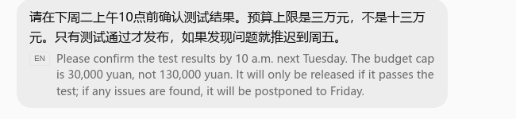
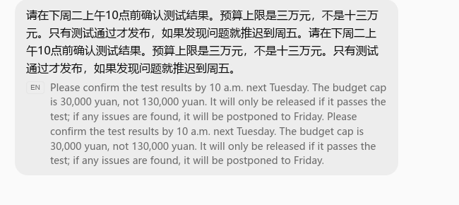

# Parley 千问与豆包版本2：参数对照

2026-11-14 按用户要求公开补充比较。千问 N05/N06 继续作为七款横评当前采用的正常录次，豆包版本2作为补充，不增加或替换原有47组采用场景。版本2为用户录屏名称，未核实构建号。保留完整两轮数据，不按指标摘取不同录次的最小值。

| 配置与录次 | 字幕首显延迟 | 译音首响延迟 | 原声开始至译音播完 | 字幕事实 |
| --- | ---: | ---: | ---: | --- |
| 千问 Live · 上海 · 实时克隆 · 首次 N05 | 3.37 秒 | 3.84 秒 | 20.03 秒 | 5/5 |
| 千问 Live · 上海 · 实时克隆 · 再次 N06 | 4.51 秒 | 5.04 秒 | 21.98 秒 | 5/5 |
| 豆包版本2 · 上海 · VV女声 · 首次 | 5.14 秒 | 5.57 秒 | 22.05 秒 | 5/5 |
| 豆包版本2 · 上海 · VV女声 · 再次 | 4.76 秒 | 5.13 秒 | 21.05 秒 | 5/5 |

千问首次输入的字幕首显和译音首响分别早约 1.77、1.73 秒；再次输入首响接近，豆包版本2从原声开始至整段译音播完短约 0.93 秒。只比较这些录次，不把千问首响和豆包完成时间合成一组结果。

两种配置均为上海线路，但千问启用实时克隆，豆包采用系统 VV 女声，各只有两轮。字幕均保留五项事实；豆包译音仅由独立音轨辅助转写核对，未做人耳音质验收。第二轮辅助转写在尾句前出现 Next，是否为实际新增词待确认。音画通路未标定，约 0.1–0.2 秒尺度的差异需谨慎解释。

## 豆包版本2原录像时间点

| 录次 | 原声起点 | 英文首显 | 稳定首句 | 译音首响 | 译音结束 | 截图时间 |
| --- | ---: | ---: | ---: | ---: | ---: | ---: |
| 首次 | 8.189 | 13.333 | 13.633 | 13.759 | 30.239 | 28.000 |
| 再次 | 31.109 | 35.867 | 36.167 | 36.239 | 52.159 | 51.000 |

单位秒，原始PTS；30 fps，从0计数的首显帧为400、1076，前一帧尚无本轮完整英文单词。第二轮只统计旧气泡后追加的新英文。声音以独立原音、译音轨10 ms RMS辅助定位，WAV第0采样对应-0.021秒，已修正。完整小数见[结构化数据](../data/parley-parameters-20261114.json)。

## 脱敏字幕证据

首次录次，原录像28秒：

同会话再次输入，原录像51秒；仅核对下方追加英文：

截图仅保留测试字幕区域。原录像冷启动、正常翻译_豆包2.mkv长53.100秒，SHA256为e6bbdef093407aabdac368526d9a941fd032b068e963aa037aac7760414b9854，原件仅留本地，未上传未脱敏原件。此次补充不提供新公开视频或人工试听结论；此前较慢豆包录次也继续仅留本地。千问公开视频及完整计时见[11月12日复测](parley-normal-retest-20261112.md)。
