# 七款同声传译软件测试报告

测试记录分析日期：2026-11-02—2026-11-04 · 发布整理日期：2026-11-06 · 环境：Windows

本报告汇总既有测试录像和最终评测记录，覆盖 Transync AI、Parley Voice、Palabra、Maestra Live、JotMe、Wordly、讯飞同传。当前采用 47 组场景、19 段录像，含 Parley Voice 千问 Live 2026-11-12 正常复测和 2026-11-11 弱网补录。原豆包正常与弱网录像 V01、V02 作为历史记录。产品具体构建版本未完整留档，结论只适用于录像所示设置与样本，不代表产品当前所有版本。

## 如何阅读

- `5/5` 表示固定语料的五项关键事实全部确认，不能解释为总体翻译准确率 100%。同稿重播不是独立语料样本。
- 首显只计本轮新出现的英文片段；首响从本轮原声声学起点计。两者都不等于整句完成时间。音画通路未经绝对标定，不计算跨软件排名、均值或 P95。
- “100ms”“10%”表示界面配置，除非另有验证，不等于实际业务 RTT 或丢包率。DevTools 页面限流和进程双向损伤不能直接等同。
- “未确认”“未观察到”“跳过”均保持原意；不填成零分。恢复后重播与旧缓存混在一起时，不给严格恢复耗时。
- 原件保留本地。公开图片和视频均为遮挡副本，截图直接取自相同遮挡规则的录像帧。视频保留时间轴，尾段裁切另见证据清单；公开副本不能替代原件进行帧级测量。

## 统一测试语料与方法

S01：请在下周二上午十点前确认测试结果，预算上限是三万元，不是十三万元。只有测试通过才发布；如果发现问题，就推迟到周五。

| 事实 | 核对内容 |
| --- | --- |
| F1 | 下周二上午十点前确认测试结果 |
| F2 | 预算上限三万元 |
| F3 | 不是十三万元 |
| F4 | 只有测试通过才发布 |
| F5 | 发现问题则推迟到周五 |

采用 ffprobe 核对流信息与显示时间戳（PTS），ffmpeg 解码；OCR 辅助定位字幕，再复核相邻帧；10ms 声学能量窗口辅助定位原声和译音。ASR 仅作内容辅证，不把自动转写结果直接当作产品字幕。混音重叠时使用同源波形抵消作辅助，抵消音不作为主音质或主声纹依据。原件内标称音轨按实际内容与解码哈希核对，不能只看音轨名称。

音色比较使用 CAMPPlus 192 维、16kHz 单声道、80 维 FBANK、dither=0、全局均值去除和原始余弦值。原始余弦不是“声音还原百分比”，短片段跨语言结果有明显适用边界。本批没有 MOS、自然度或韵律盲听评分。

## 核心观察

| 软件 | 正常场景的五事实核对 | 首次首显 / 首响（秒） | 主要限制 |
| --- | --- | --- | --- |
| Transync AI | 最终字幕和对应译音 5/5 | 4.8 / 18.3 | 再次输入首响较早；不能用少量录次推算稳定性 |
| Parley Voice | 最终字幕和对应译声 5/5 | 3.4 / 3.8 | 千问 Live 上海线路，首次会话，实时克隆开启 |
| Palabra | 最终字幕 5/5；部分译音币种未确认 | 14.3 / 14.8 | 新历史块整段出现；克隆开关未在录像展示 |
| Maestra Live | 最终字幕及对应独立译音 5/5 | 3.7 / 16.0 | 首显常是未完成的中间稿 |
| JotMe | 正常和 100ms 录次 3/5，金额错误 | 3.9 / 5.1 | 单独 10% 录次 5/5，不能归因为丢包改善 |
| Wordly | 基线最终字幕 5/5，发布对象措辞有歧义 | 2.3 / 未确认 | 首次播音关闭；后期开启播音录次首响 15.1 秒 |
| 讯飞同传 | 正常与发送端配置录次字幕/译音 5/5 | 3.0 / 9.6 | 收听侧多窗口，后半段译音归属受限 |

表格是观测摘要，各行条件、音轨和取样不同，不能作为同条件速度排名。

## Transync AI

### 翻译事实覆盖

中→英，统一S01两句短语料。正常3条、100ms档1条、上下行各10%概率丢包配置1条，5条完整输出的最终字幕各5/5事实正确，共25/25项检查通过。日期时间、预算上限3万元、不是13万元、测试通过才发布、有问题推迟至周五均保留。
流式中间字幕仍有误译：冷启动约22～23秒曾将“预算上限”译成budget up or down，约24秒修正，最终字幕及播报正确。
10秒中断恢复的新段只有2项完整正确、1项部分、2项遗漏：发布条件及周五延期保留，只剩30,000 yuan金额，首句和“不是13万”缺失。
5/5仅为本语料事实覆盖；25项来自同一语料的5次输出，不能当总体准确率。重叠语音用同源抵消辅助转写核对，10%实际业务丢包未验证。

### 音色克隆

3D-Speaker CAMPPlus声纹模型（192维），同一S01语义内容的中文输入与英文译音对照：输入原声→克隆0.6002，输入原声→默认0.0742，原始余弦分差0.5259。另用独立克隆参考音频，参考→克隆0.6817、参考→默认0.1571，排序一致。
主比较取样：输入13.48秒、克隆15.60秒、默认12.94秒；两段译音均无中文源音重叠，未使用抵消音算主声纹。
结论：本样本克隆音色的模型特征明显更接近原声。0.6002不能解释为60.02%还原率；跨语言、短样本，无通用身份阈值及主观盲听，不能推断长期稳定性。10%补录虽开启克隆，但语音重叠，未混入主声纹比较。

### 实时性能

OBS录像离线观测；下列均从S01最早声学活动起算，顺序为“英文字幕首显／同句译音首响”，单位秒：
首次启动·克隆：4.81／18.25；同进程新会话·克隆：4.91／6.94；默认音色：5.67／16.10。
上下行各100ms：6.09／7.89；上下行各10%概率丢包配置：5.98／8.10。
首次会话从开始受理到明确就绪约0.83秒，不等于进程启动耗时，也不等于可听到译音。冷启动字幕后还需13.44秒才发声；同进程克隆约2.03秒，10%补录约2.12秒。
按ASR首词“请”计，冷启动为4.06／17.51秒，10%补录为5.25／7.37秒。主口径含前导低能量声段；视频30fps，OBS通路未标定，重叠首响定位约±0.1秒。各条件仅1条对应观测，不报告稳定均值或P95。

### 译音质量

正常无重叠完整译音中，克隆／默认的首末发声跨度为15.53／12.86秒，峰值幅度0.381／0.275（满幅为1），数字削波占比均0.0%。段间停顿：克隆约0.41～0.56秒，默认约0.20～0.54秒。独立英文转写均恢复5项事实，未见整句内容重复。
10%概率丢包配置补录：辅助转写恢复5项事实，发声跨度13.27秒；未重叠尾段峰值0.188、削波0.0%，两处短语停顿约0.53／0.96秒。
结论：本样本可懂性证据较好、未见满幅数字过载。停顿不能直接判为卡顿，完整转写不能排除词内断音、机械感或细微失真。
三条标记音轨实为相同混音，抵消音只作内容／时间辅助。自然度、韵律、主观清晰度均未做人耳评分；无MOS、PESQ或STOI分数。

### 弱网表现

100ms档：上、下行各附加100ms，首显6.09秒、首响7.89秒，完整输出，最终字幕5/5事实。设置值不等于实测RTT。
10%概率丢包档：上、下行各配置10%，克隆开启，首显5.98秒、首响8.10秒，字幕和译音均保留5项事实；29.654秒完成播报。相对同进程克隆场景，首显观测多1.07秒、首响多1.16秒。工具注明“实测丢弃比例未采集、业务覆盖待验证”，不能宣称稳定耐受真实10%丢包。
10秒中断：界面控制状态54.800～65.033秒，约10.23秒。撤销后约13秒才见新英文金额，约13.49秒记录到金额发声，约82秒补出发布条件及周五延期；新字幕完整事实2/5，预算仅金额，首句及否定信息缺失。
局限：撤销后68.524秒同文重播、约84.13秒结束会话，补译归属及后续播报未完全观察。只判本次观察内恢复不完整，不判永久丢失或严格超时率。各网络条件仅1条观测，单次差异不能归因于网络损伤。

### 测试状态与证据缺口

现有录像分析完成。
实际弱网强度：未采集业务丢包率，未验证控制覆盖，100ms/10%仅为配置。
断网恢复耗时：撤销后同稿重播且随后结束会话，缺少可区分缓存补译的完整连续记录。
稳定延迟/总体准确率：同一短语料、少量录次，音画通路未校准。
自然度/韵律：缺少人耳盲听评分。
克隆长期稳定性：仅跨语言短样本，缺少多语料、多次对照。

### 场景与证据

| 场景 | 本轮最终字幕事实 | 对应译音事实 | 原录像 PTS | 复核入口 |
| --- | --- | --- | --- | --- |
| N01 首次启动·克隆开启 | 正确 / 正确 / 正确 / 正确 / 正确 | 正确 / 正确 / 正确 / 正确 / 正确 | transync-normal · 48.904s | [截图](../evidence/images/transync-n01.png) · [视频](https://github.com/ElmerElla/simultaneous-translation-benchmark/releases/download/v1.0-20261106/transync-normal.mp4#t=48.904) |
| N02 同进程新会话·克隆开启 | 正确 / 正确 / 正确 / 正确 / 正确 | 正确 / 正确 / 正确 / 正确 / 正确 | transync-normal · 81.129s | [截图](../evidence/images/transync-n02.png) · [视频](https://github.com/ElmerElla/simultaneous-translation-benchmark/releases/download/v1.0-20261106/transync-normal.mp4#t=81.129) |
| N03 同进程新会话·默认音色 | 正确 / 正确 / 正确 / 正确 / 正确 | 正确 / 正确 / 正确 / 正确 / 正确 | transync-normal · 124.454s | [截图](../evidence/images/transync-n03.png) · [视频](https://github.com/ElmerElla/simultaneous-translation-benchmark/releases/download/v1.0-20261106/transync-normal.mp4#t=124.454) |
| W01 上行100ms+下行100ms | 正确 / 正确 / 正确 / 正确 / 正确 | 正确 / 正确 / 正确 / 正确 / 正确 | transync-network · 39.194s | [截图](../evidence/images/transync-w01.png) · [视频](https://github.com/ElmerElla/simultaneous-translation-benchmark/releases/download/v1.0-20261106/transync-network.mp4#t=39.194) |
| W02 中断10秒期间的输入 | 归属不唯一，见说明 | 归属不唯一，见说明 | transync-network · 64.000s | [截图](../evidence/images/transync-w02.png) · [视频](https://github.com/ElmerElla/simultaneous-translation-benchmark/releases/download/v1.0-20261106/transync-network.mp4#t=64.0) |
| W03 撤销中断后同文重播 | 归属不唯一，见说明 | 归属不唯一，见说明 | transync-network · 82.800s | [截图](../evidence/images/transync-w03.png) · [视频](https://github.com/ElmerElla/simultaneous-translation-benchmark/releases/download/v1.0-20261106/transync-network.mp4#t=82.8) |
| W04 上下行各10%概率丢包·克隆开启 | 正确 / 正确 / 正确 / 正确 / 正确 | 正确（抵消辅助） / 正确（抵消辅助） / 正确 / 正确 / 正确 | transync-loss10 · 30.000s | [截图](../evidence/images/transync-w04.png) · [视频](https://github.com/ElmerElla/simultaneous-translation-benchmark/releases/download/v1.0-20261106/transync-loss10.mp4#t=30) |

事实顺序为 F1—F5。下方列出证据截图；每条详细备注及收听页状态见 `data/results.json`。

**N01 · 首次启动·克隆开启 · transync-normal / 48.904s**

首响用无源音重叠区；仅1次首次启动样本。

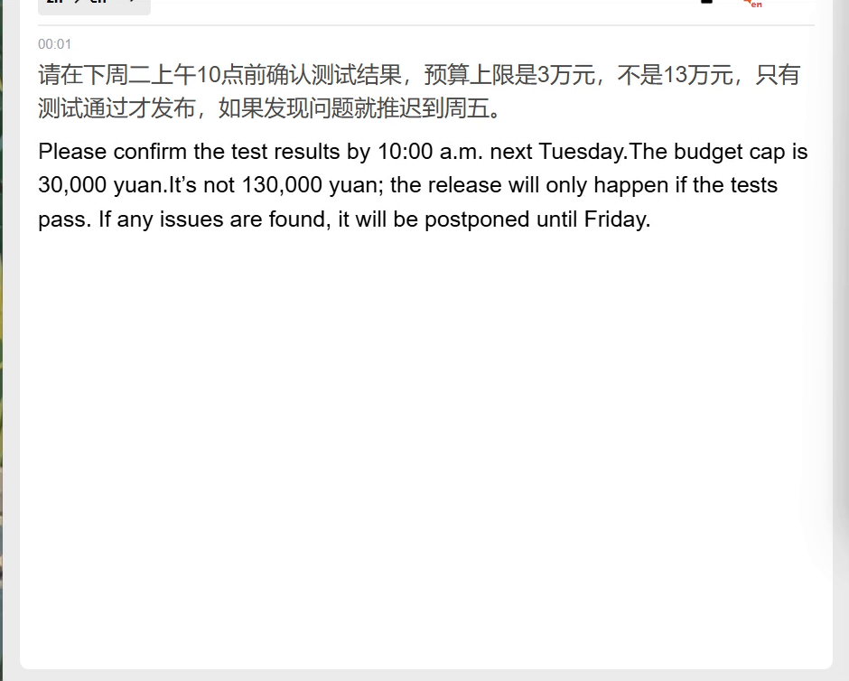

**N02 · 同进程新会话·克隆开启 · transync-normal / 81.129s**

首响与中文源音重叠，经同源波形抵消辅助定位，误差约±0.1秒。

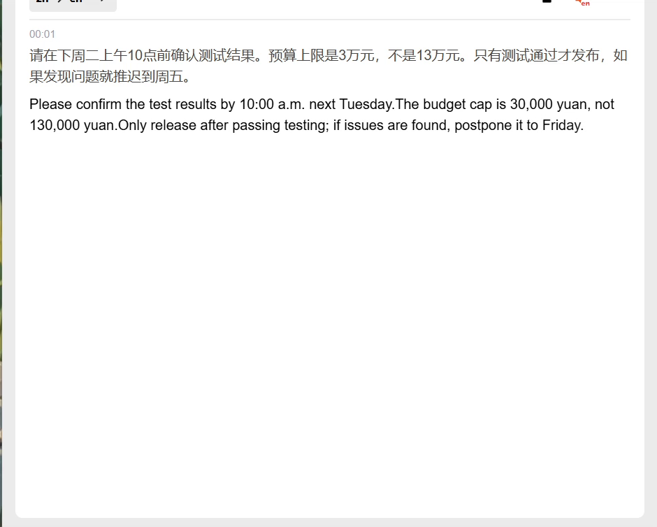

**N03 · 同进程新会话·默认音色 · transync-normal / 124.454s**

90～91秒关闭声音克隆，选择深沉男声-A。

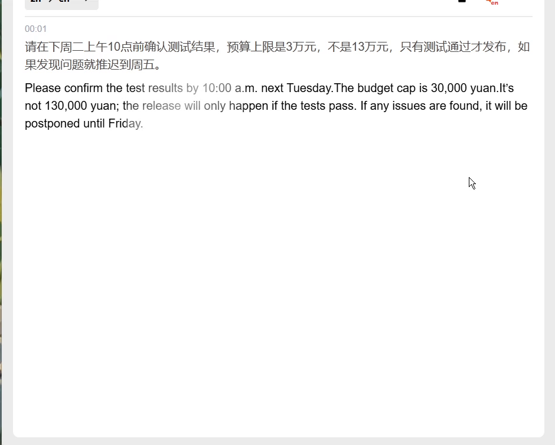

**W01 · 上行100ms+下行100ms · transync-network / 39.194s**

首响重叠，经同源抵消辅助定位；网络数值为工具设置。

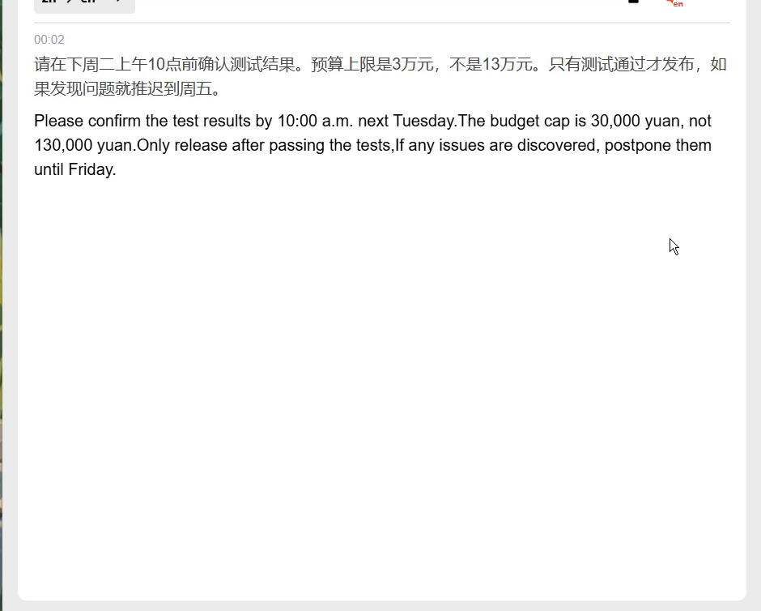

**W02 · 中断10秒期间的输入 · transync-network / 64.000s**

旧字幕保留；恢复后同文重播，无法把残段唯一归属原输入。

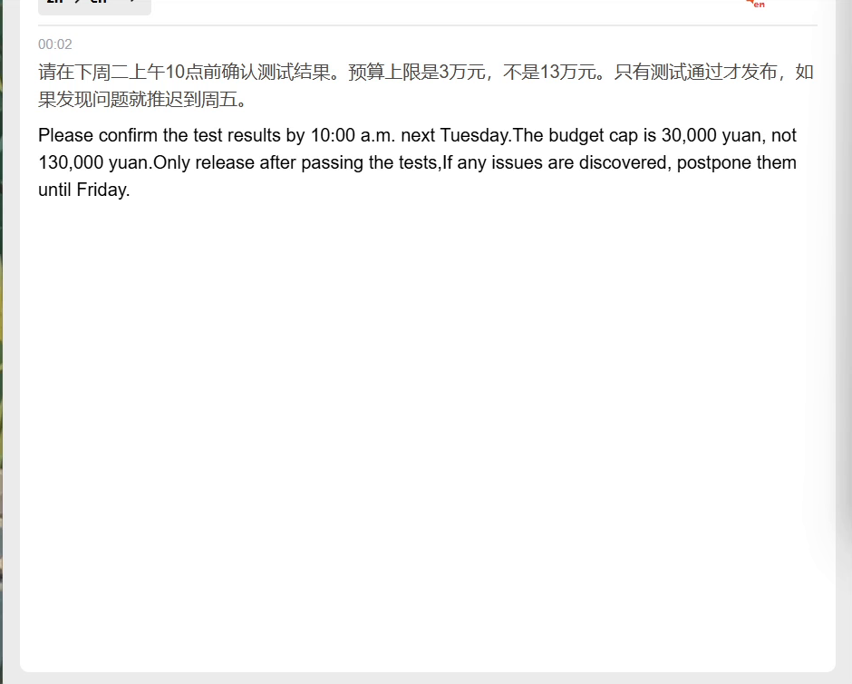

**W03 · 撤销中断后同文重播 · transync-network / 82.800s**

78秒附近出现新字幕30,000 yuan，78.526秒附近发声；84.13秒附近停止，未等待完整播报。

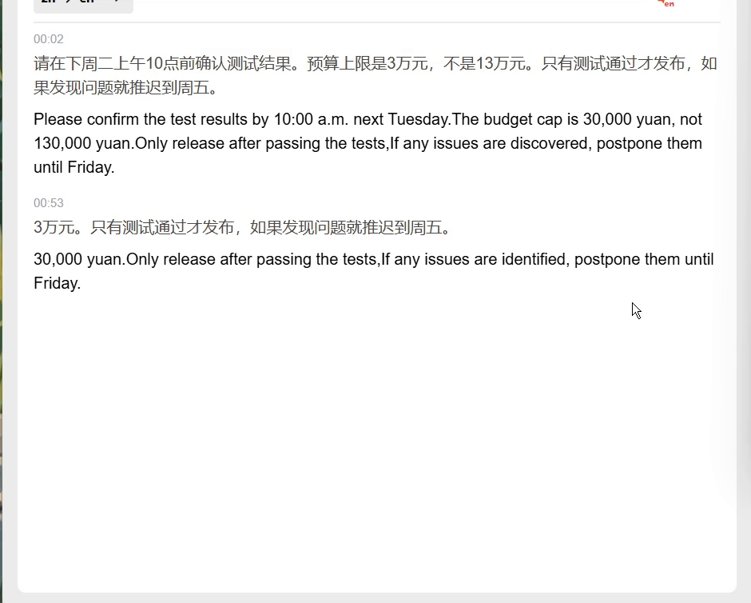

**W04 · 上下行各10%概率丢包·克隆开启 · transync-loss10 / 30.000s**

工具只显示配置上/下行10%，实测丢弃比例未采集，业务覆盖待验证。；1条样本，无统计稳定性结论。进程已在录像开始时打开，此条不记冷启动。；三音轨解码后相同，首句/预算与源音重叠，用同源抵消辅助ASR；不据此作完整音质或新声纹主比较。；会话结束附近工具显示控制对象变无，未单独验证撤销后恢复表现。

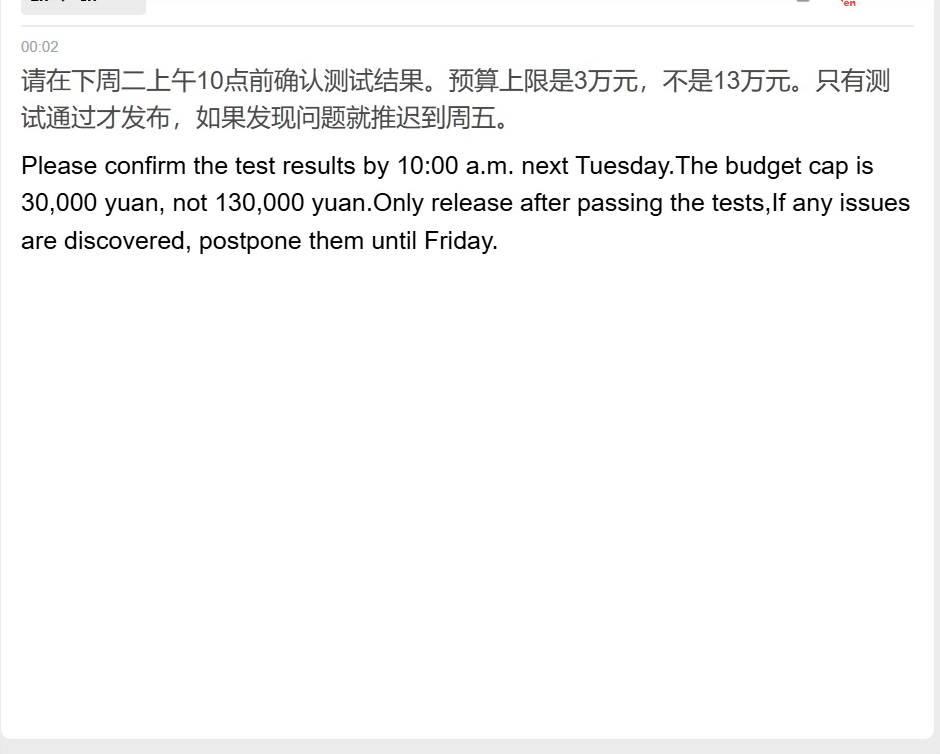

## Parley Voice

### 翻译事实覆盖

千问 Live 正常两轮及 100 ms 配置、10% 丢包配置、解除中断后重播三轮，英文字幕和录入译声均为 5/5。约 10 秒中断轮至重播前无新输出。豆包历史克隆 C01 仍为 3 项完整、1 项部分、1 项错误。

### 音色克隆

千问 Live 补录两轮均启用实时克隆，无默认音色对照。本次保留实时克隆录次 C01。该录次的无重叠 F4–F5 英文尾句与原声参考的 CAMPPlus 原始余弦为 0.5450，仅描述该短样本。

### 实时性能

客户端窗口约 5.63 秒出现，6.70 秒显示配置页，间隔约 1.1 秒。7.67 秒进入音频准备，8.97 秒进入监听，间隔约 1.3 秒。
千问 Live 11 月 12 日上海线路首轮首显／首响约 3.4／3.8 秒，同会话再次输入约 4.5／5.0 秒。11 月 11 日新加坡线路样本分别为 4.4／4.5 与 4.2／4.1 秒。
千问 Live 弱网录像首显／首响约为 100 ms 配置 5.0／5.2 秒、重播后 4.8／4.5 秒、10% 丢包配置 4.6／4.7 秒。重播差值从重播原声起点算。
11 月 11 日新加坡线路的两轮数据可在复测对照中查看。[复测对照](parley-normal-retest-20261112.md)

#### 11 月 14 日千问与豆包版本2补充比较

| 配置与录次 | 字幕首显延迟 | 译音首响延迟 | 原声开始至译音播完 | 字幕事实 |
| --- | ---: | ---: | ---: | --- |
| 千问 Live · 上海 · 实时克隆 · 首次 N05 | 3.37 秒 | 3.84 秒 | 20.03 秒 | 5/5 |
| 千问 Live · 上海 · 实时克隆 · 再次 N06 | 4.51 秒 | 5.04 秒 | 21.98 秒 | 5/5 |
| 豆包版本2 · 上海 · VV女声 · 首次 | 5.14 秒 | 5.57 秒 | 22.05 秒 | 5/5 |
| 豆包版本2 · 上海 · VV女声 · 再次 | 4.76 秒 | 5.13 秒 | 21.05 秒 | 5/5 |

千问首次输入的字幕首显和译音首响分别早约 1.77、1.73 秒；再次输入首响接近，豆包版本2从原声开始至整段译音播完短约 0.93 秒。只比较这些录次，不把千问首响和豆包完成时间合成一组结果。

两种配置均为上海线路，但千问启用实时克隆，豆包采用系统 VV 女声，各只有两轮。字幕均保留五项事实；豆包译音仅由独立音轨辅助转写核对，未做人耳音质验收。第二轮辅助转写在尾句前出现 Next，是否为实际新增词待确认。音画通路未标定，约 0.1–0.2 秒尺度的差异需谨慎解释。

[完整对照与脱敏截图](parley-parameters-20261114.md) · [结构化参数](../data/parley-parameters-20261114.json)

### 豆包短句与停顿辅助示例（Mac，2026-11-14）

此录像为Mac补充示例，不替换千问Windows数据，也不纳入固定S01五项事实评分。“你好”后约有0.5秒停顿，再输入“请问今天下午的会议几点开始？”；最终字幕为“Hello, what time does this afternoon meeting start?”，问候、今天下午、会议开始时间的含义保留。

| 示例 | 原声起点 | 新英文首显 | 字幕延迟 | 译音首响延迟 |
| --- | --- | --- | --- | --- |
| 你好，随后停顿 | 约4.03秒 | 5.70–5.75秒之间 | 约1.7秒 | 混音与后续中文重叠，未唯一确认 |
| 请问今天下午的会议几点开始 | 约4.94秒 | 8.30–8.40秒之间 | 约3.4秒 | 约3.37秒（8.31秒开始） |

以上为原录像时间，以相邻抽样画面给出边界区间，不冒充逐帧精确值；原声与英文语音由混音波形和本地辅助转写交叉定位，未做人耳验收，音画通路未标定。短句在停顿后较早显示译文，与长段连续输入需要更长等待的现象一致；停顿可能帮助系统确定分句，但此处句长、平台和输入内容同时不同，不能证明停顿必然降低延迟。需同稿有/无停顿重复试验才能判断因果。

[播放脱敏辅助录像](https://github.com/ElmerElla/simultaneous-translation-benchmark/releases/download/parley-doubao-pause-20261114/parley-doubao-pause-20261114.mp4)

### 译音质量

C01 克隆录次的无重叠 F4–F5 尾句峰值 0.908，满幅数字削波 0%，段间停顿约 0.16–0.65 秒。独立尾段转写保留发布条件与周五延期。11 月 12 日正常复测可用单独的英文译音轨核对两轮事实，未做主观音质或声纹重测。

### 弱网表现

100 ms 配置与 10% 丢包配置各观察到一次完整字幕和译声。约 10 秒中断配置在录像 40.13–50.27 秒显示倒计时；输入从 37.17 秒开始，53.22 秒同稿重播前无新字幕或译声。重播后出现一套完整输出，自动补译和严格恢复耗时无法单独确认。
弱网工作台提示检测到可能的本机中转，业务覆盖待验证。各条件仅一轮，实测业务延迟和丢包率未独立采集。

### 测试状态与证据缺口

当前采用 11 月 12 日千问 Live 正常两轮、11 月 11 日千问 Live 弱网四轮及豆包克隆 C01。旧正常与弱网录像仍可供对照。

### 场景与证据

| 场景 | 本轮最终字幕事实 | 对应译音事实 | 原录像 PTS | 复核入口 |
| --- | --- | --- | --- | --- |
| N05 千问 Live · 上海线路首次开启会话 | 5/5 | 5/5 | parley-qwen-normal-retest-20261112 · 26.000s | [截图](../evidence/images/parley-n05.png) · [视频](https://github.com/ElmerElla/simultaneous-translation-benchmark/releases/download/parley-normal-retest-20261112/parley-qwen-normal-retest-20261112.mp4#t=26) |
| N06 千问 Live · 上海线路同会话再次输入 | 5/5 | 5/5 | parley-qwen-normal-retest-20261112 · 50.000s | [截图](../evidence/images/parley-n06.png) · [视频](https://github.com/ElmerElla/simultaneous-translation-benchmark/releases/download/parley-normal-retest-20261112/parley-qwen-normal-retest-20261112.mp4#t=50) |
| C01 豆包/实时克隆输入声音 | 错误 / 部分 / 正确 / 正确 / 正确 | 错误 / 部分 / 正确 / 正确 / 正确 | parley-v03 · 25.000s | [截图](../evidence/images/parley-c01.png) · [视频](https://github.com/ElmerElla/simultaneous-translation-benchmark/releases/download/v1.0-20261106/parley-v03.mp4#t=25) |
| W05 千问 Live · 上下行各 100 ms 配置 | 5/5 | 5/5 | parley-qwen-network-20261111 · 29.000s | [截图](../evidence/images/parley-w05.png) · [视频](https://github.com/ElmerElla/simultaneous-translation-benchmark/releases/download/parley-network-retest-20261111/parley-qwen-network-20261111.mp4#t=29) |
| R03 千问 Live · 约 10 秒中断 | 未观察到 | 未观察到 | parley-qwen-network-20261111 · 49.000s | [截图](../evidence/images/parley-r03.png) · [视频](https://github.com/ElmerElla/simultaneous-translation-benchmark/releases/download/parley-network-retest-20261111/parley-qwen-network-20261111.mp4#t=49) |
| R04 千问 Live · 解除中断后同稿重播 | 5/5 | 5/5 | parley-qwen-network-20261111 · 72.000s | [截图](../evidence/images/parley-r04.png) · [视频](https://github.com/ElmerElla/simultaneous-translation-benchmark/releases/download/parley-network-retest-20261111/parley-qwen-network-20261111.mp4#t=72) |
| W06 千问 Live · 上下行各 10% 概率丢包配置 | 5/5 | 5/5 | parley-qwen-network-20261111 · 97.000s | [截图](../evidence/images/parley-w06.png) · [视频](https://github.com/ElmerElla/simultaneous-translation-benchmark/releases/download/parley-network-retest-20261111/parley-qwen-network-20261111.mp4#t=97) |

事实顺序为 F1—F5。下方列出证据截图；每条详细备注及收听页状态见 `data/results.json`。

**N05 · 千问 Live · 上海线路首次开启会话 · 26.000s**

从桌面打开客户端。上海线路，开启实时克隆。首轮把「确认测试结果」的动作和对象分两段输出，合读保留截止时间及对象。独立译音保留五项事实。

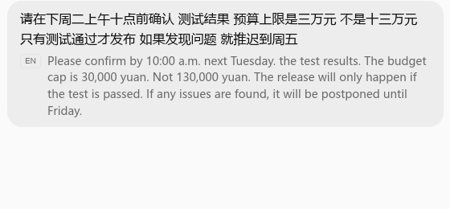

**N06 · 千问 Live · 上海线路同会话再次输入 · 50.000s**

只核对同一气泡中新追加的英文。独立译音保留五项事实。

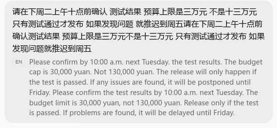

**C01 · 豆包/实时克隆输入声音 · parley-v03 / 25.000s**

画面明确实时克隆输入声音；F1仍错，F2只保留金额未保留预算上限，记部分。

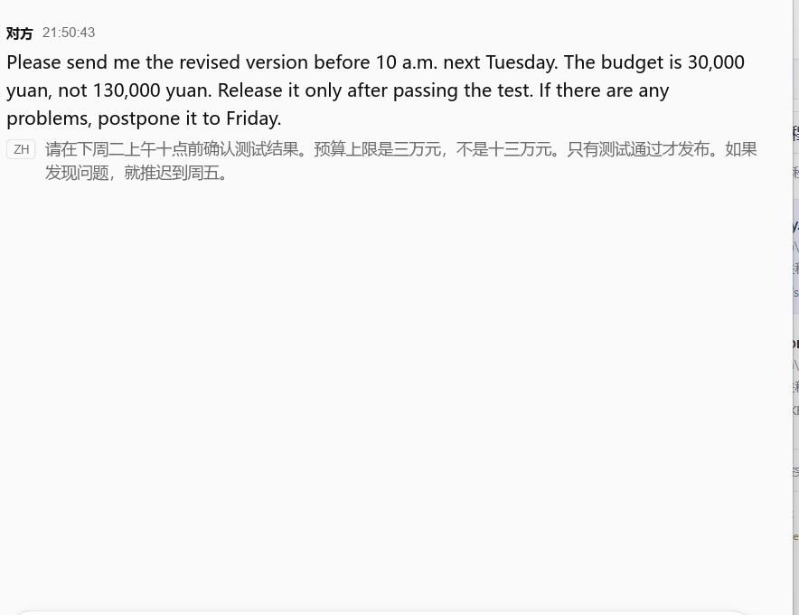

**W05 · 千问 Live · 上下行各 100 ms 配置 · 29.000s**

弱网工作台约 5.27 秒显示 parley.exe 上下行各 100 ms，31.80 秒显示控制对象为无。本轮完整输出在配置显示期间结束。

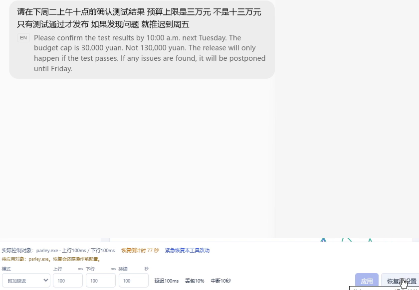

**R03 · 千问 Live · 约 10 秒中断 · 49.000s**

本轮原声从 37.17 秒开始，工具在约 40 秒显示连接中断，50.27 秒显示控制对象为无。53.22 秒重播前无本轮新字幕或译声。截图中的字幕来自上一轮。

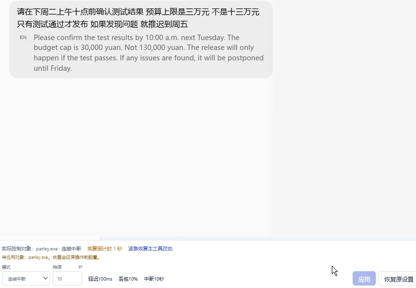

**R04 · 千问 Live · 解除中断后同稿重播 · 72.000s**

解除配置约 3.0 秒后重播同稿，随后观察到一套完整新输出。差值从重播原声起点计算，录像无法唯一排除前轮残留或确定自动恢复耗时。

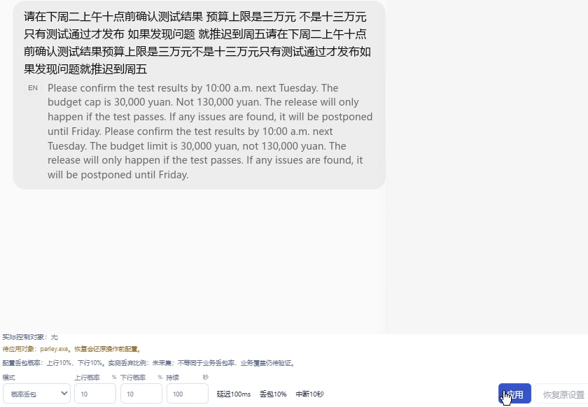

**W06 · 千问 Live · 上下行各 10% 概率丢包配置 · 97.000s**

约 75.80 秒显示对 parley.exe 配置上下行各 10% 概率丢包。F1 追加在上一气泡尾部，F2–F5 出现在下一气泡。工具标明实际丢弃比例未采集。

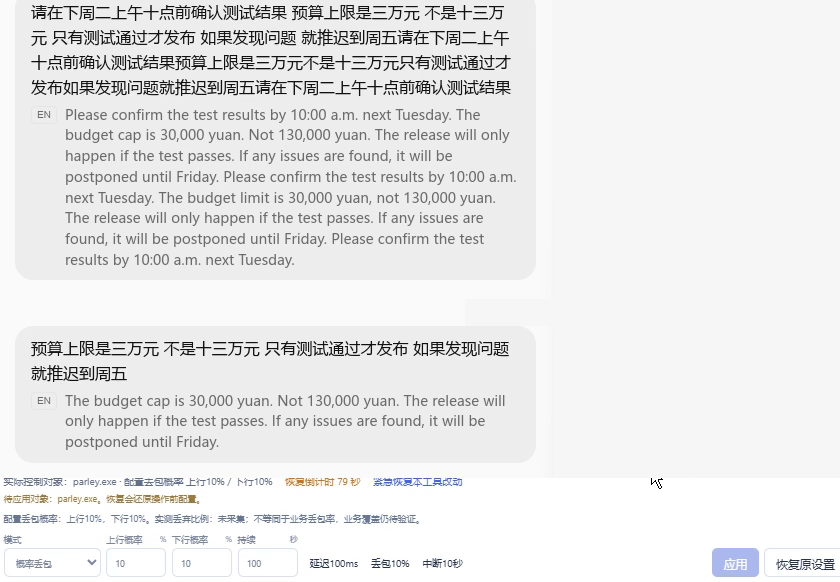

## Palabra

### 翻译事实覆盖

正常2条、标称克隆、100ms配置及恢复后重播：最终新字幕均5/5事实。首次、标称克隆、100ms及重播译音核对到5项；正常录次及10%配置的译音转写出现yen/yuan歧义，各有币种两项未确认，其他3项保留。
中断输入后新段仅为“Please postpone it from next Tuesday to Friday.”：完整事实0/5、部分1项，其余错误或遗漏；旧完整块不计入。71.8秒明确重播后才见完整新输出。

### 音色克隆

CAMPPlus 192维声纹；同一原声参考与无重叠F2～F5英文片段比较：标称克隆0.5822、正常录次0.1979，原始余弦差0.3844。
本样本标称克隆片段更接近原声；正常与克隆开关未在录像中展示，不能据此严格证明“开启克隆”造成差异。跨语言短样本，无主观盲听；相似度不是还原百分比。

### 实时性能

首显／首响，单位秒；均从本轮原声声学起点计。
首次14.3/14.8；正常14.4/14.9；标称克隆14.7/15.4；100ms14.5/15.1；10%16.4/15.9。
字幕在历史新块中整段出现，不能算成较早已有旧块。单次录像观察；音画通路未标定，无稳定均值或P95。
启动分阶段：主界面在12～15秒出现；会话就绪在30～31秒之间，输入32.0秒才开始。
首次尾句显全距输入14.3秒；译音末响距输入26.3秒。尾句首度显全不代表后续不再修订或重复。

### 译音质量

未重叠F2～F5片段峰值：正常0.049、标称克隆0.387；100ms完整译音0.273、10%完整译音0.285，满幅削波均0%。
正常与标称克隆录次音量差异明显，未作响度校准；低音量下能量阈值造成的断续区间不直接判卡顿。字幕及独立转写支持可懂性；正常及10%录次译音币种待人工听辨。自然度、韵律未盲听评分。

### 弱网表现

100ms及10%配置下均出现完整新字幕；本地工具控制Palabra.ai.exe，配置上下行分别100ms或10%。真实业务丢包比例未验证。
约54～64秒中断，输入51.2秒已开始；撤销后只出现错误的周二推迟到周五短段。71.8秒重播后完整输出，不能把重播结果当成前次缓存自动补齐。

### 测试状态与证据缺口

现有录像分析完成。
克隆效果归因：未展示默认/克隆开关，缺少可核对设置的同条件对照。
译音币种：正常及10%录次有yen（日元）/yuan（元）转写歧义，缺少人工听辨确认。
断网恢复耗时：完整输出出现在重播后，缺少无重播的连续恢复记录。
实际弱网强度：未验证业务丢包率及控制覆盖。
稳定延迟/总体准确率：短语料、少量录次、通路未校准；自然度/韵律未盲听评分。

### 场景与证据

| 场景 | 本轮最终字幕事实 | 对应译音事实 | 原录像 PTS | 复核入口 |
| --- | --- | --- | --- | --- |
| N01 首次录次 | 正确 / 正确 / 正确 / 正确 / 正确 | 正确 / 正确 / 正确 / 正确 / 正确 | palabra-v01 · 59.000s | [截图](../evidence/images/palabra-n01.png) · [视频](https://github.com/ElmerElla/simultaneous-translation-benchmark/releases/download/v1.0-20261106/palabra-v01.mp4#t=59) |
| N02 正常录制 | 正确 / 正确 / 正确 / 正确 / 正确 | 正确 / 未确认 / 未确认 / 正确 / 正确 | palabra-v03 · 40.000s | [截图](../evidence/images/palabra-n02.png) · [视频](https://github.com/ElmerElla/simultaneous-translation-benchmark/releases/download/v1.0-20261106/palabra-v03.mp4#t=40) |
| C01 文件标称音色克隆 | 正确 / 正确 / 正确 / 正确 / 正确 | 正确 / 正确 / 正确 / 正确 / 正确 | palabra-v04 · 43.000s | [截图](../evidence/images/palabra-c01.png) · [视频](https://github.com/ElmerElla/simultaneous-translation-benchmark/releases/download/v1.0-20261106/palabra-v04.mp4#t=43) |
| W01 上下行各100ms配置 | 正确 / 正确 / 正确 / 正确 / 正确 | 正确 / 正确 / 正确 / 正确 / 正确 | palabra-v02 · 46.000s | [截图](../evidence/images/palabra-w01.png) · [视频](https://github.com/ElmerElla/simultaneous-translation-benchmark/releases/download/v1.0-20261106/palabra-v02.mp4#t=46) |
| W02 中断后短残段 | 错误 / 遗漏 / 遗漏 / 遗漏 / 部分 | 错误 / 遗漏 / 遗漏 / 遗漏 / 部分 | palabra-v02 · 70.000s | [截图](../evidence/images/palabra-w02.png) · [视频](https://github.com/ElmerElla/simultaneous-translation-benchmark/releases/download/v1.0-20261106/palabra-v02.mp4#t=70) |
| W03 恢复后重新播放 | 正确 / 正确 / 正确 / 正确 / 正确 | 正确 / 正确 / 正确 / 正确 / 正确 | palabra-v02 · 100.000s | [截图](../evidence/images/palabra-w03.png) · [视频](https://github.com/ElmerElla/simultaneous-translation-benchmark/releases/download/v1.0-20261106/palabra-v02.mp4#t=100) |
| W04 上下行各10%概率丢包配置 | 正确 / 正确 / 正确 / 正确 / 正确 | 正确 / 未确认 / 未确认 / 正确 / 正确 | palabra-v02 · 132.000s | [截图](../evidence/images/palabra-w04.png) · [视频](https://github.com/ElmerElla/simultaneous-translation-benchmark/releases/download/v1.0-20261106/palabra-v02.mp4#t=132) |

事实顺序为 F1—F5。下方列出证据截图；每条详细备注及收听页状态见 `data/results.json`。

**N01 · 首次录次 · palabra-v01 / 59.000s**

历史面板新块出现后核对，不计上方旧块。英文译音在源音结束后，可独立核对。

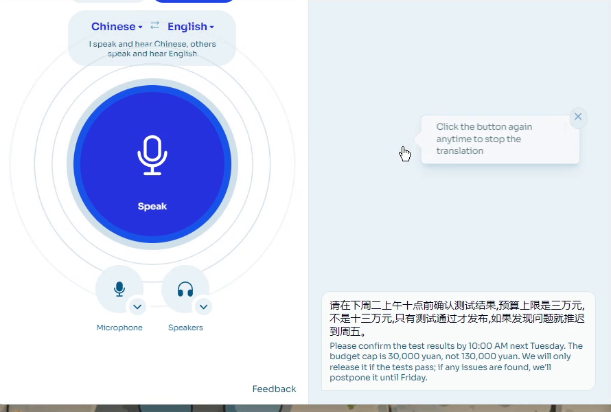

**N02 · 正常录制 · palabra-v03 / 40.000s**

新输出为第二个历史块；原始无重叠全段独立转写与辅助转写对币种给出yen/yuan不同结果，F2/F3译音记未确认，不判产品错译。译音前几词原自动时间戳偏早，最终首响改由原音波形定位。

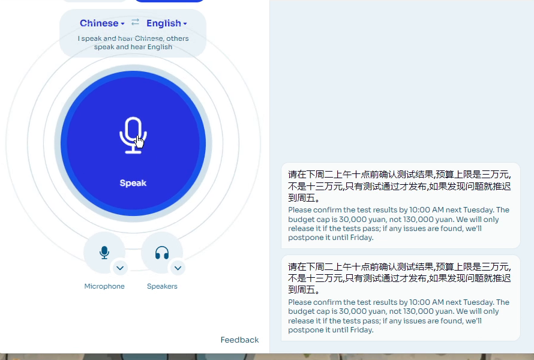

**C01 · 文件标称音色克隆 · palabra-v04 / 43.000s**

文件名标称克隆；录像未展示声音克隆开关，不把名称当作开关状态已验证。

**W01 · 上下行各100ms配置 · palabra-v02 / 46.000s**

新历史块与完整译音均保留5项事实。

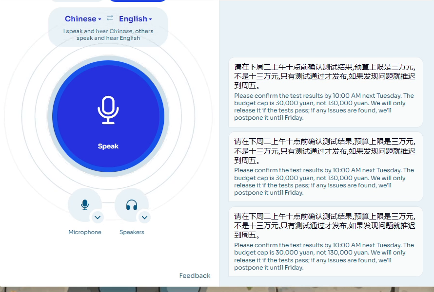

**W02 · 中断后短残段 · palabra-v02 / 70.000s**

中断配置约54～64秒，51.2秒已开始输入。新段只剩一句错误改写；F5缺少发现问题的条件，仅记部分。上方完整旧块不计入。

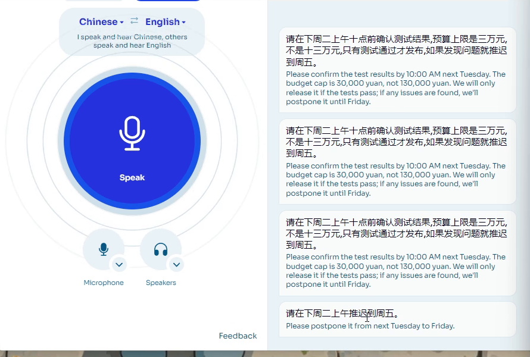

**W03 · 恢复后重新播放 · palabra-v02 / 100.000s**

71.8秒明确重播；完整输出不能追溯填补前一次中断输入。

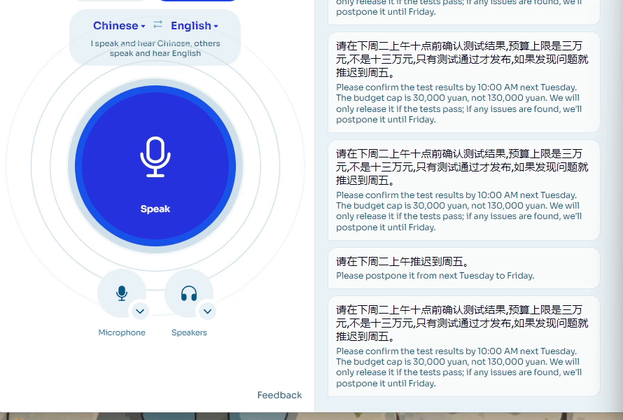

**W04 · 上下行各10%概率丢包配置 · palabra-v02 / 132.000s**

字幕币种为yuan；译音自动转写出现yen，币种未做人耳确认，F2/F3译音记未确认，不直接判产品错译。

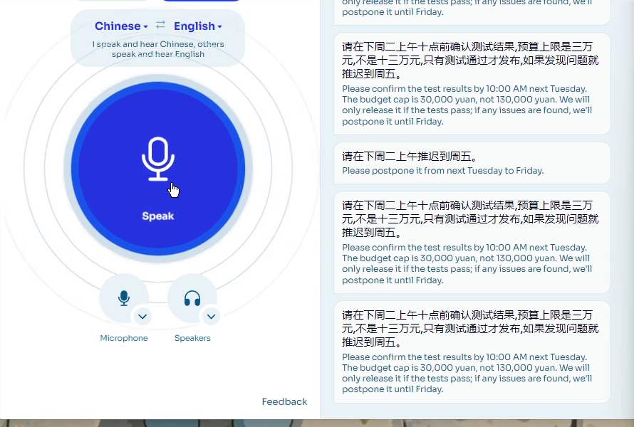

## Maestra Live

### 翻译事实覆盖

首次、既有正常录次、100ms配置、Offline恢复段和10%配置段，最终新字幕各5/5关键事实；对应无重叠完整译音的独立转写也保留5项。
首显常为Please next Tuesday / Please by next Tuesday等不完整中间稿；恢复首稿Please go后来修正。5/5是本语料事实覆盖，不代表总体准确率。既有正常录像原件校验一致，已复核复用。

### 音色克隆

本次按原评测范围跳过，未开展音色克隆验收；不据此判断产品是否支持该功能。

### 实时性能

首显／首响，单位秒；均从本轮原声声学起点计。
首次3.7/16.0；既有正常3.0/17.2；100ms配置3.7/15.7；10%配置6.3/17.6。
字幕较早出现，译音多在原声结束后才播出。既有正常录次输入波形不同，按自身原声测量。单次录像观察；音画通路未标定，无稳定均值或P95。
启动分阶段：浏览器1～2秒打开；产品主页5～6秒可见；会话就绪10～10.5秒，输入11.0秒开始。
首次尾句显全距输入14.2秒；译音末响距输入27.7秒。尾句首度显全不代表后续不再修订或重复。

### 译音质量

5段无重叠完整英文译音峰值约0.577～0.584，满幅数字削波均0%；能量阈值下短语停顿约0.23～0.75秒。
独立转写各保留5项事实，未见本批完整译音的整句重复。可支持本样本可懂性及无满幅过载，不能证明无细微断音或机械感；自然度、韵律未盲听评分。

### 弱网表现

DevTools页面配置：100ms、约37～47秒Offline、随后10% Packet Loss；与本地工具“上下行各100ms/10%”不能等同。
100ms和10%配置段均有完整新字幕/译音。Offline期间有WebSocket/GET断网报错；撤销后新字幕逐步修正，完整译音在下一次71.8秒重播前结束，5项事实保留。
只验证可见页面状态，未独立确认整个翻译链路的实际丢包与作用范围。

### 测试状态与证据缺口

现有录像分析完成。
弱网作用范围：仅见浏览器开发工具页面配置及报错，缺少整个实时翻译链路受控和实际丢包率的验证。
稳定恢复能力：本次撤销后已见完整译音，但缺少重复中断样本及链路覆盖验证。
稳定延迟/总体准确率：同一短语料、少量录次，音画通路未校准。
自然度/细微失真：缺少人工盲听评分；完整转写和无数字削波不能证明自然或无细微断音。

### 场景与证据

| 场景 | 本轮最终字幕事实 | 对应译音事实 | 原录像 PTS | 复核入口 |
| --- | --- | --- | --- | --- |
| N01 首次录次/Puck | 正确 / 正确 / 正确 / 正确 / 正确 | 正确 / 正确 / 正确 / 正确 / 正确 | maestra-v01 · 38.000s | [截图](../evidence/images/maestra-n01.png) · [视频](https://github.com/ElmerElla/simultaneous-translation-benchmark/releases/download/v1.0-20261106/maestra-v01.mp4#t=38) |
| N02 既有正常录次/Puck | 正确 / 正确 / 正确 / 正确 / 正确 | 正确 / 正确 / 正确 / 正确 / 正确 | maestra-v03 · 30.000s | [截图](../evidence/images/maestra-n02.png) · [视频](https://github.com/ElmerElla/simultaneous-translation-benchmark/releases/download/v1.0-20261106/maestra-v03.mp4#t=30) |
| W01 DevTools延迟100ms配置 | 正确 / 正确 / 正确 / 正确 / 正确 | 正确 / 正确 / 正确 / 正确 / 正确 | maestra-v02 · 33.000s | [截图](../evidence/images/maestra-w01.png) · [视频](https://github.com/ElmerElla/simultaneous-translation-benchmark/releases/download/v1.0-20261106/maestra-v02.mp4#t=33) |
| W02 Offline撤销后新段 | 正确 / 正确 / 正确 / 正确 / 正确 | 正确 / 正确 / 正确 / 正确 / 正确 | maestra-v02 · 68.500s | [截图](../evidence/images/maestra-w02.png) · [视频](https://github.com/ElmerElla/simultaneous-translation-benchmark/releases/download/v1.0-20261106/maestra-v02.mp4#t=68.5) |
| W04 DevTools 10%丢包配置 | 正确 / 正确 / 正确 / 正确 / 正确 | 正确 / 正确 / 正确 / 正确 / 正确 | maestra-v02 · 100.000s | [截图](../evidence/images/maestra-w04.png) · [视频](https://github.com/ElmerElla/simultaneous-translation-benchmark/releases/download/v1.0-20261106/maestra-v02.mp4#t=100) |

事实顺序为 F1—F5。下方列出证据截图；每条详细备注及收听页状态见 `data/results.json`。

**N01 · 首次录次/Puck · maestra-v01 / 38.000s**

自动声音克隆关闭。流式首显仅Please next Tuesday，最终补齐5项事实。

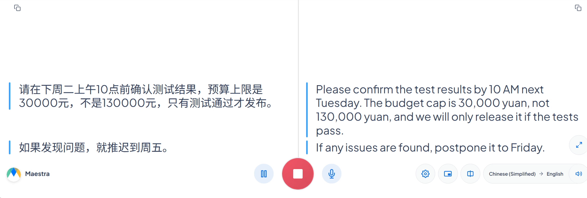

**N02 · 既有正常录次/Puck · maestra-v03 / 30.000s**

原件SHA256与2026-11-02旧分析一致；该录次输入波形与本轮其他录像不同，单独用其本身原声定位。

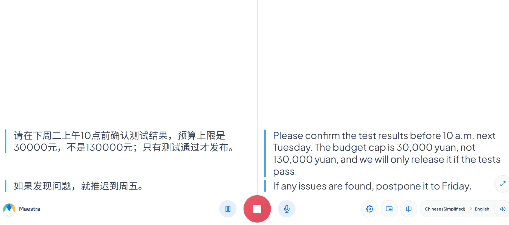

**W01 · DevTools延迟100ms配置 · maestra-v02 / 33.000s**

首显只是Please by next Tuesday，最终字幕和独立译音均保留5项。

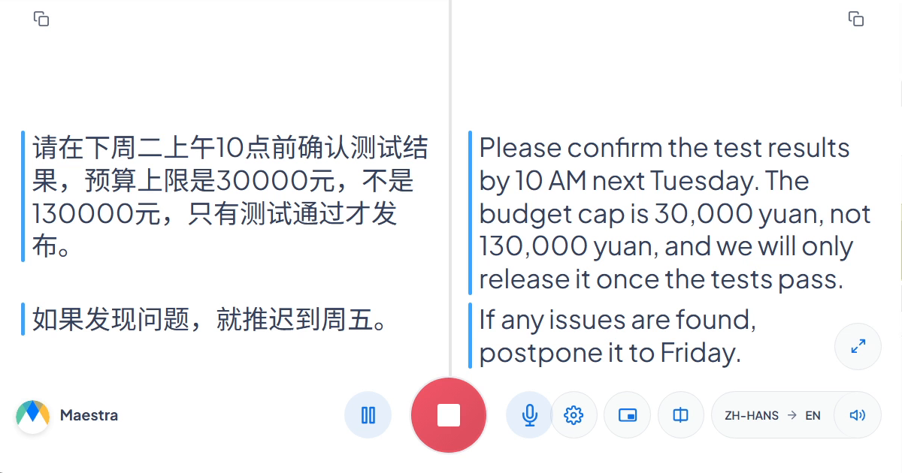

**W02 · Offline撤销后新段 · maestra-v02 / 68.500s**

35.9秒输入跨越约37～47秒Offline；撤销后先出现Please go再修正并完成。完整译音在71.8秒下一次重播前结束，可归属本段。

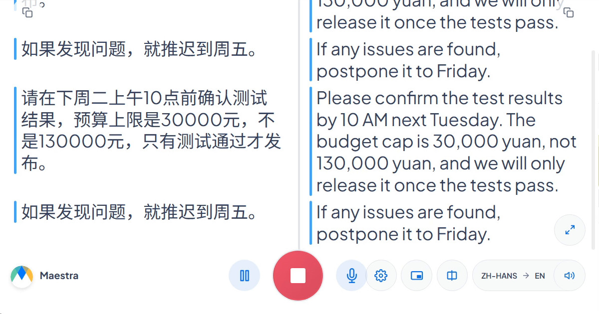

**W04 · DevTools 10%丢包配置 · maestra-v02 / 100.000s**

画面显示10% Packet Loss配置；未独立验证WebRTC或实际业务包覆盖。

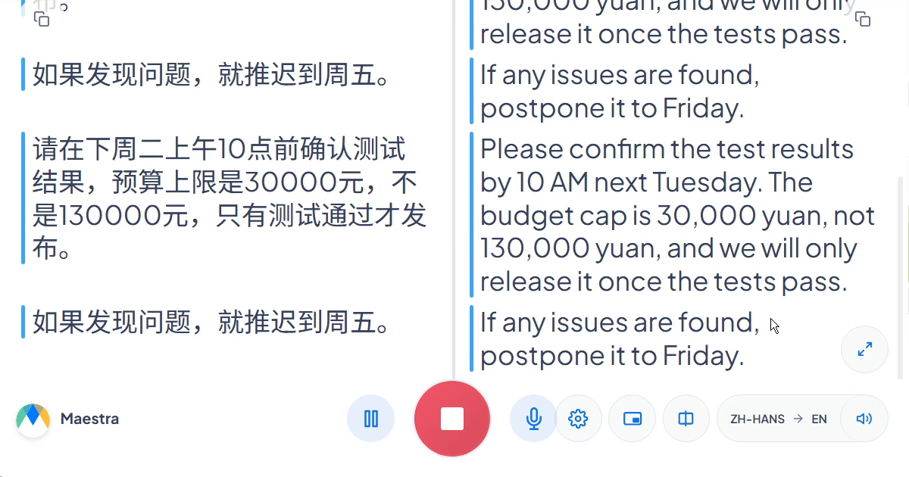

## JotMe

### 翻译事实覆盖

统一S01中→英。首次、同进程重播及100ms配置录次，最终字幕和辅助译音均为3/5完整事实：截止时间、发布条件及周五延期保留；3万元被改成13万元或30万元，“不是13万元”被改成“不是130万元”。
单独10%丢包配置录次最终字幕及辅助译音5/5；不能据此推断丢包改善准确性。恢复与重播合并段仍有金额错误，归属受限。

### 音色克隆

本次按原评测范围跳过，未开展音色克隆验收；不据此判断产品是否支持该功能。

### 实时性能

首显／首响，单位秒；均从本轮原声声学起点计。
首次3.9/5.1；再次5.6/6.9；100ms配置5.5/6.6；10%配置5.1/6.5。
单次录像观察；音画通路未标定，无稳定均值或P95。源音与译音重叠，首响由同源抵消辅助定位；首显仅首个英文片段，不等于完整句。
启动分阶段：程序加载约2～8秒区间；会话就绪在录像14～15秒之间，输入17.5秒才开始。
首次尾句显全距输入18.3秒；译音末响距输入19.7秒。尾句首度显全不代表后续不再修订或重复。

### 译音质量

干净尾段峰值：首次0.159、再次0.174、10%配置0.257；满幅数字削波均0%。
再次输入后，发布条件和周五延期又播报一遍；保留字幕及独立尾段转写证据。10%录次有超过2秒的停顿，但不能仅凭停顿判网络卡顿。
混音重叠区无法完整评音质；未做自然度、韵律或MOS盲听评分。

### 弱网表现

100ms：画面显示对JotMe.exe上、下行各附加100ms；输出完整但金额错译。
10%：单独录像显示概率丢包配置，上下行各10%；最终字幕/辅助译音5项事实保留，真实业务丢包率未采集。
中断：约31～41秒显示控制；24.5秒已开始输入，38.8秒再次输入，随后新段及额外播报交错。只能描述本次新输出，无法给出严格恢复耗时或缓存补译归属。

### 测试状态与证据缺口

现有录像分析完成。
实际弱网强度：仅有100ms/10%配置记录，缺少实际业务丢包率及控制覆盖验证。
断网恢复耗时：输入跨中断且同稿重播，缺少能区分缓存补译和新输入的连续记录。
完整译音质量：原声与译音重叠，缺少整段独立译音；自然度/韵律未盲听评分。
稳定延迟/总体准确率：同一短语料、少量录次，音画通路未校准。

### 场景与证据

| 场景 | 本轮最终字幕事实 | 对应译音事实 | 原录像 PTS | 复核入口 |
| --- | --- | --- | --- | --- |
| N01 首次录次 | 正确 / 错误 / 错误 / 正确 / 正确 | 正确 / 错误 / 错误 / 正确 / 正确 | jotme-v03 · 39.000s | [截图](../evidence/images/jotme-n01.png) · [视频](https://github.com/ElmerElla/simultaneous-translation-benchmark/releases/download/v1.0-20261106/jotme-v03.mp4#t=39) |
| N02 同进程重播 | 正确 / 错误 / 错误 / 正确 / 正确 | 正确 / 错误 / 错误 / 正确 / 正确 | jotme-v03 · 70.000s | [截图](../evidence/images/jotme-n02.png) · [视频](https://github.com/ElmerElla/simultaneous-translation-benchmark/releases/download/v1.0-20261106/jotme-v03.mp4#t=70) |
| W01 上下行各100ms配置 | 正确 / 错误 / 错误 / 正确 / 正确 | 正确 / 错误 / 错误 / 正确 / 正确 | jotme-v02 · 23.000s | [截图](../evidence/images/jotme-w01.png) · [视频](https://github.com/ElmerElla/simultaneous-translation-benchmark/releases/download/v1.0-20261106/jotme-v02.mp4#t=23) |
| R01 中断与重播合并新段 | 正确 / 错误 / 错误 / 正确 / 正确 | 正确 / 错误 / 错误 / 正确 / 正确 | jotme-v02 · 52.000s | [截图](../evidence/images/jotme-r01.png) · [视频](https://github.com/ElmerElla/simultaneous-translation-benchmark/releases/download/v1.0-20261106/jotme-v02.mp4#t=52) |
| W04 上下行各10%概率丢包配置 | 正确 / 正确 / 正确 / 正确 / 正确 | 正确 / 正确 / 正确 / 正确 / 正确 | jotme-v01 · 37.000s | [截图](../evidence/images/jotme-w04.png) · [视频](https://github.com/ElmerElla/simultaneous-translation-benchmark/releases/download/v1.0-20261106/jotme-v01.mp4#t=37) |

事实顺序为 F1—F5。下方列出证据截图；每条详细备注及收听页状态见 `data/results.json`。

**N01 · 首次录次 · jotme-v03 / 39.000s**

字幕与抵消辅助译音均把3万改成13万、13万改成130万。最终结果未修正。

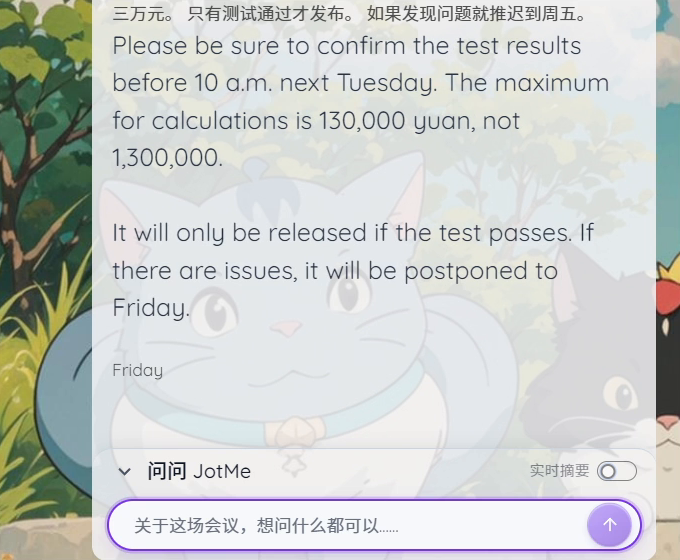

**N02 · 同进程重播 · jotme-v03 / 70.000s**

尾句又出现一次发布条件和周五延期；仅一次S01输入后重复播报，不把重复当独立样本。

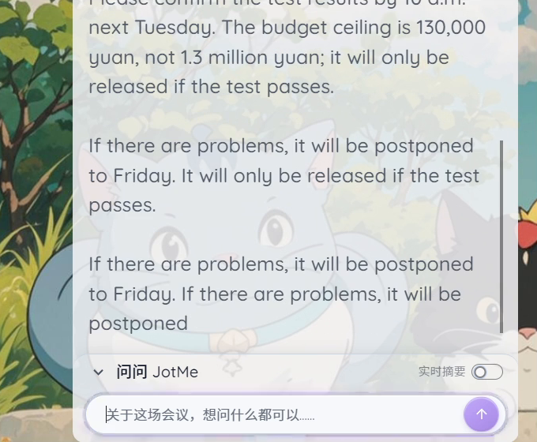

**W01 · 上下行各100ms配置 · jotme-v02 / 23.000s**

以工具已应用状态核对；金额均多一位数量级。

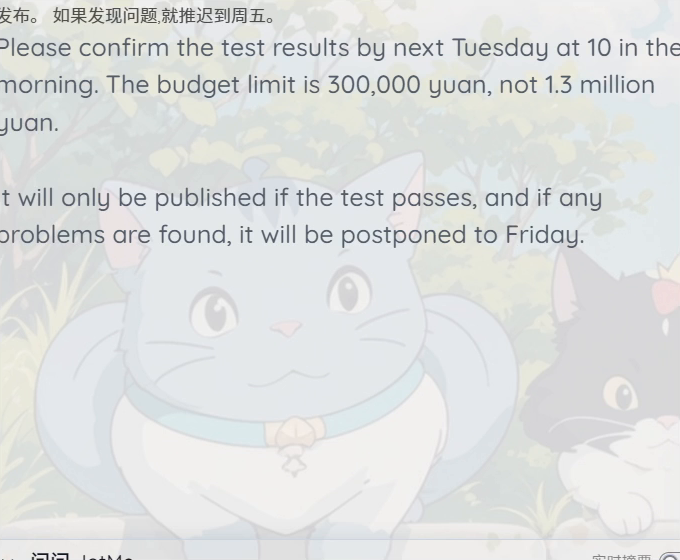

**R01 · 中断与重播合并新段 · jotme-v02 / 52.000s**

24.5秒输入先于中断真正应用，38.8秒又输入；40～52秒新输出无法严格归属某一轮，不能计算单轮完整恢复耗时。

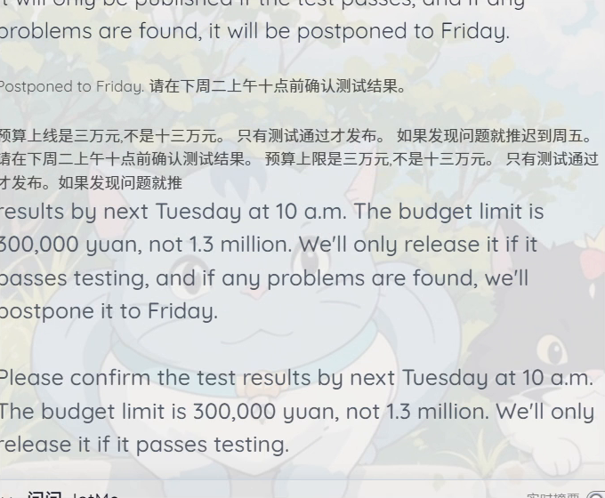

**W04 · 上下行各10%概率丢包配置 · jotme-v01 / 37.000s**

字幕写thirty thousand与one hundred thirty thousand；辅助译音也恢复5项。仅为该配置录次，真实业务丢包率未验证。

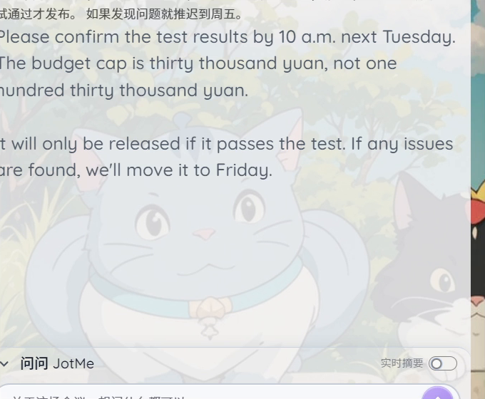

## Wordly

### 翻译事实覆盖

首次字幕及弱网录像前两条No throttling基线，最终新字幕保留5项关键事实；开启播音后的独立译音也恢复5项。英文把发布/延期对象写成test，表达有歧义，不能把5/5理解为整段措辞无误。
100ms两次输入有新字幕，关键事实保留；未确认对应新译音。正常录像后段丢包配置的新字幕缺next Tuesday，完整事实4/5、部分1项。末次10%输入的新输出未确认。

### 音色克隆

本次按原评测范围跳过，未开展音色克隆验收；不据此判断产品是否支持该功能。

### 实时性能

首显／首响，单位秒；均从本轮原声声学起点计。
首次字幕2.3秒，初期静音未测首响；开启播音后录次首响15.1秒。No throttling基线为2.2/16.0、2.4/15.1。
100ms两次新字幕约2.3和15.5秒，未确认新译音；第二次有重播/队列干扰。单次录像观察；音画通路未标定，无稳定均值或P95。
启动分阶段：浏览器打开时间缺失；讲话端2～4秒、听众端4～6秒加入，路由配置8～10秒完成；初期播音关闭。
首次尾句显全距输入14.0秒；译音末响距输入未确认。尾句首度显全不代表后续不再修订或重复。

### 译音质量

开启播音后完整译音峰值0.659；另两段No throttling基线0.658/0.653，满幅数字削波均0%，短语停顿约0.17～0.75秒。独立转写可恢复5项事实，但test作为发布/延期对象有歧义。
早期静音和弱网段未录入的新译音不能评分，也不能据此断言产品不支持语音。未做自然度、韵律盲听评分。

### 弱网表现

“弱网”录像0～约76秒仍是No throttling，11.6/45.2秒输入仅为基线。约77秒后听众页选择100ms，字幕有更新，未记录可归属新英文播报；讲话端为另一浏览器页面，作用范围未验证。
约131秒选10%配置后又输入，录像149.6秒结束前未确认新输出，旧字幕不计成功。正常录像后段也曾选丢包配置，新字幕遗漏星期二。
未找到连续约10秒应用Offline的证据，不能给中断恢复结论。

### 测试状态与证据缺口

现有录像分析完成。
10秒断网恢复：未找到连续约10秒应用Offline（离线）的记录，缺少合格中断、撤销及恢复过程。
弱网新译音/新输出：100ms未录到可确认的新译音；10%末次输入在录像结束前未确认新输出，缺少独立录音及后续观察。
弱网作用范围：仅听众页配置，缺少讲话端/实时连接受控及实际丢包率验证。
稳定延迟/总体准确率：短语料、少量录次、通路未校准。
自然度/韵律：缺少人工盲听评分。

### 场景与证据

| 场景 | 本轮最终字幕事实 | 对应译音事实 | 原录像 PTS | 复核入口 |
| --- | --- | --- | --- | --- |
| N01 首次字幕录次 | 正确 / 正确 / 正确 / 正确 / 正确 | 未确认 / 未确认 / 未确认 / 未确认 / 未确认 | wordly-v01 · 28.000s | [截图](../evidence/images/wordly-n01.png) · [视频](https://github.com/ElmerElla/simultaneous-translation-benchmark/releases/download/v1.0-20261106/wordly-v01.mp4#t=28) |
| N03 开启播音后的录次 | 未确认 / 未确认 / 未确认 / 未确认 / 未确认 | 正确 / 正确 / 正确 / 正确 / 正确 | wordly-v01 · 82.800s | [截图](../evidence/images/wordly-n03.png) · [视频](https://github.com/ElmerElla/simultaneous-translation-benchmark/releases/download/v1.0-20261106/wordly-v01.mp4#t=82.8) |
| N04 正常录像后段10%配置 | 部分 / 正确 / 正确 / 正确 / 正确 | 未确认 / 未确认 / 未确认 / 未确认 / 未确认 | wordly-v01 · 100.000s | [截图](../evidence/images/wordly-n04.png) · [视频](https://github.com/ElmerElla/simultaneous-translation-benchmark/releases/download/v1.0-20261106/wordly-v01.mp4#t=100) |
| B01 弱网录像/No throttling基线1 | 正确 / 正确 / 正确 / 正确 / 正确 | 正确 / 正确 / 正确 / 正确 / 正确 | wordly-v02 · 27.000s | [截图](../evidence/images/wordly-b01.png) · [视频](https://github.com/ElmerElla/simultaneous-translation-benchmark/releases/download/v1.0-20261106/wordly-v02.mp4#t=27) |
| B02 弱网录像/No throttling基线2 | 正确 / 正确 / 正确 / 正确 / 正确 | 正确 / 正确 / 正确 / 正确 / 正确 | wordly-v02 · 61.000s | [截图](../evidence/images/wordly-b02.png) · [视频](https://github.com/ElmerElla/simultaneous-translation-benchmark/releases/download/v1.0-20261106/wordly-v02.mp4#t=61) |
| W01a DevTools 100ms/首次输入 | 正确 / 正确 / 正确 / 正确 / 正确 | 未确认 / 未确认 / 未确认 / 未确认 / 未确认 | wordly-v02 · 96.000s | [截图](../evidence/images/wordly-w01a.png) · [视频](https://github.com/ElmerElla/simultaneous-translation-benchmark/releases/download/v1.0-20261106/wordly-v02.mp4#t=96) |
| W01b DevTools 100ms/继续重播 | 正确 / 正确 / 正确 / 正确 / 正确 | 未确认 / 未确认 / 未确认 / 未确认 / 未确认 | wordly-v02 · 118.000s | [截图](../evidence/images/wordly-w01b.png) · [视频](https://github.com/ElmerElla/simultaneous-translation-benchmark/releases/download/v1.0-20261106/wordly-v02.mp4#t=118) |
| W04 DevTools 10%/末次输入 | 未确认 / 未确认 / 未确认 / 未确认 / 未确认 | 未确认 / 未确认 / 未确认 / 未确认 / 未确认 | wordly-v02 · 149.000s | [截图](../evidence/images/wordly-w04.png) · [视频](https://github.com/ElmerElla/simultaneous-translation-benchmark/releases/download/v1.0-20261106/wordly-v02.mp4#t=149) |

事实顺序为 F1—F5。下方列出证据截图；每条详细备注及收听页状态见 `data/results.json`。

**N01 · 首次字幕录次 · wordly-v01 / 28.000s**

听众端早期静音，未记录本轮英文播报。F4/F5把发布、延期对象写成test，存在表达歧义；关键条件和日期保留。

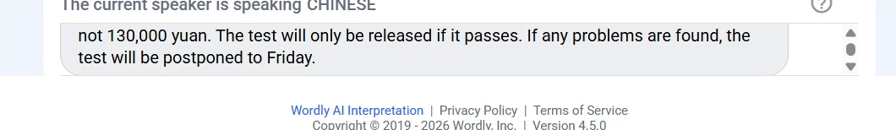

**N03 · 开启播音后的录次 · wordly-v01 / 82.800s**

输入52.8秒，原音67.9～82.7秒为完整独立英文译音；约76秒后切换丢包设置，播报尾部跨设置改变，不算全段严格纯正常网络。重复语料且画面旧字幕保留，本轮新字幕无法独立计分。

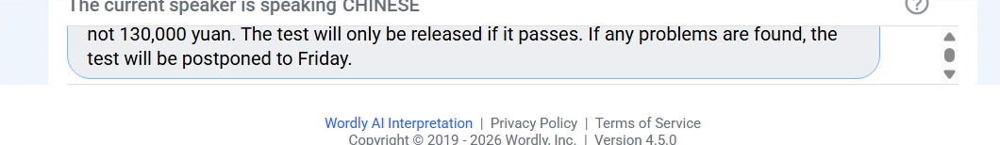

**N04 · 正常录像后段10%配置 · wordly-v01 / 100.000s**

该文件后段切换WebRTC丢包配置。可见新段没有保留next Tuesday；不纳入正常基线，也无可确认新译音。

**B01 · 弱网录像/No throttling基线1 · wordly-v02 / 27.000s**

此时明确显示No throttling，不当作100ms或中断结果。独立英文译音约27.6秒起。

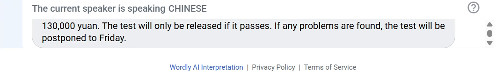

**B02 · 弱网录像/No throttling基线2 · wordly-v02 / 61.000s**

此时仍为No throttling。初期test results budget等中间稿后来修正；最终5项保留。

**W01a · DevTools 100ms/首次输入 · wordly-v02 / 96.000s**

源音81.4秒，新please在83.7秒出现；最终新字幕可核对，未记录可归属的新英文译音。

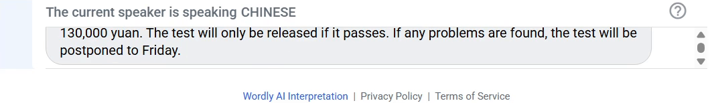

**W01b · DevTools 100ms/继续重播 · wordly-v02 / 118.000s**

99.5秒又输入，115秒完整新字幕才出现；重复和队列影响存在，不作为独立冷启动或稳定均值。

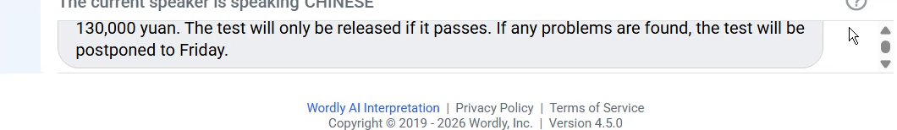

**W04 · DevTools 10%/末次输入 · wordly-v02 / 149.000s**

131.9秒输入后，录像于149.6秒结束；未确认新的对应字幕或英文播报。下方仍在的旧字幕不能算本轮成功，也不能据此断言永久丢失。

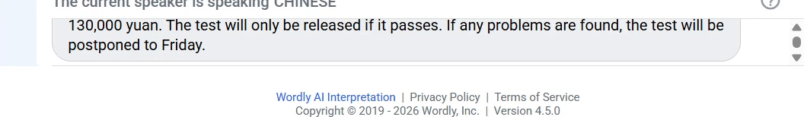

## 讯飞同传

### 翻译事实覆盖

统一S01中→英。首次、再次、发送端100ms及10%配置轮次，最终新字幕与录入译音各保留5项关键事实。
发送端中断这一轮，在下一次重播前未观察到完整新S01；旧字幕不计成功。
收听侧100ms/Offline轮次录音F1只保留时间或结果片段，完整事实4/5、部分1项；末次录音未检出发布条件。末次客户端字幕完整，可见收听页未更新。多个收听窗口使后半段译音归属受限。5/5仅指本语料事实覆盖，另有4、3、Yes等额外片段，来源未确认。

### 音色克隆

本次按原评测范围跳过，未开展音色克隆验收；不据此判断产品是否支持该功能。

### 实时性能

录像观测，非校准正式成绩。按“客户端英文首显／录入译音首响”，从原音声学起点计，单位秒：
首次3.0/9.6；再次3.3/9.4；发送端100ms 3.4/9.8；发送端10% 3.3/9.8。
收听页100ms 3.0/9.2；Offline相关输入3.5/11.5；WebRTC丢包配置3.5/10.9。后半段音频未隔离到受控窗口，不能当该页面的严格首响成绩。
启动页2～4秒、首页6～8秒、会话计时22～24秒、收听页30～32秒就绪；原音35.2秒开始。首次末响距输入27.6秒、句尾拖尾14.2秒。各条件仅一次，OBS通路未校准，不报均值或P95。

### 译音质量

原录像48kHz双声道译音解码检查：7段S01输出片段峰值约0.782～0.811（满幅1），满幅数字削波均0%。正常前两轮分段静音最长约4.5/6.3秒，不能仅凭停顿判网络卡顿。
首次、再次及发送端100ms/10%录音转写保留5项；收听侧两轮首句不完整，末次录音未检出发布条件。
“混音”轨实际主要为英文，另外两轨主要为中文；按内容选轨。无数字削波不代表无细微失真。自然度、韵律未盲听评分；后半段多窗口的声音来源未独立隔离。

### 弱网表现

发送端：讯飞同传.exe上/下行各100ms配置，完成本轮；约129～139秒中断，下一次155.9秒重播前无完整新S01。10%概率丢包约155秒应用、175～176秒撤销，译音181.1秒才结束，尾部跨撤销。实际业务损伤未验证。
收听端：DevTools 100ms不能等同双向各100ms；约249～261秒“离线”期间仍有新字幕/录入译音，未证实实时链路断流。约273秒后WebRTC丢包配置，客户端新字幕完整，收听页到录像结束仍停留旧段。录音有新英文但多窗口归属受限，不能据此判受控页丢包下成功。
各档一次，配置值不是实测业务丢包率；无严格恢复耗时。

### 测试状态与证据缺口

现有录像分析完成。
弱网作用范围：收听端Offline（离线）时仍有新输出，未证实实时连接断流；发送端实际业务丢包率未测。
收听端首响/译音：多窗口声音未隔离，缺少可归属于受控窗口的独立录音。
断网恢复耗时：重播前未见本轮完整新输出，缺少无重播干扰的后续恢复观察。
稳定延迟/总体准确率：短语料、少量录次，音画通路未校准。
自然度/韵律：缺少人工盲听评分。

### 场景与证据

| 场景 | 客户端字幕事实 | 收听页字幕事实 | 录像译声事实 | 原录像 PTS | 复核入口 |
| --- | --- | --- | --- | --- | --- |
| N01 首次输入 | 正确 / 正确 / 正确 / 正确 / 正确 | 正确 / 正确 / 正确 / 正确 / 正确 | 正确 / 正确 / 正确 / 正确 / 正确 | iflytek-v01 · 54.000s | [截图](../evidence/images/iflytek-n01.png) · [视频](https://github.com/ElmerElla/simultaneous-translation-benchmark/releases/download/v1.0-20261106/iflytek-v01.mp4#t=54) |
| N02 正常再次输入 | 正确 / 正确 / 正确 / 正确 / 正确 | 正确 / 正确 / 正确 / 正确 / 正确 | 正确 / 正确 / 正确 / 正确 / 正确 | iflytek-v01 · 84.000s | [截图](../evidence/images/iflytek-n02.png) · [视频](https://github.com/ElmerElla/simultaneous-translation-benchmark/releases/download/v1.0-20261106/iflytek-v01.mp4#t=84) |
| S100 客户端上下行各100ms配置 | 正确 / 正确 / 正确 / 正确 / 正确 | 正确 / 正确 / 正确 / 正确 / 正确 | 正确 / 正确 / 正确 / 正确 / 正确 | iflytek-v01 · 120.000s | [截图](../evidence/images/iflytek-s100.png) · [视频](https://github.com/ElmerElla/simultaneous-translation-benchmark/releases/download/v1.0-20261106/iflytek-v01.mp4#t=120) |
| Soff 客户端中断相关输入 | 本轮未观察到 / 本轮未观察到 / 本轮未观察到 / 本轮未观察到 / 本轮未观察到 | 本轮未观察到 / 本轮未观察到 / 本轮未观察到 / 本轮未观察到 / 本轮未观察到 | 本轮未观察到 / 本轮未观察到 / 本轮未观察到 / 本轮未观察到 / 本轮未观察到 | iflytek-v01 · 142.000s | [截图](../evidence/images/iflytek-soff.png) · [视频](https://github.com/ElmerElla/simultaneous-translation-benchmark/releases/download/v1.0-20261106/iflytek-v01.mp4#t=142) |
| Sdrop 客户端上下行各10%丢包配置 | 正确 / 正确 / 正确 / 正确 / 正确 | 正确 / 正确 / 正确 / 正确 / 正确 | 正确 / 正确 / 正确 / 正确 / 正确 | iflytek-v01 · 182.000s | [截图](../evidence/images/iflytek-sdrop.png) · [视频](https://github.com/ElmerElla/simultaneous-translation-benchmark/releases/download/v1.0-20261106/iflytek-v01.mp4#t=182) |
| R100 收听页100ms配置 | 正确 / 正确 / 正确 / 正确 / 正确 | 正确 / 正确 / 正确 / 正确 / 正确 | 部分 / 正确 / 正确 / 正确 / 正确 | iflytek-v01 · 240.000s | [截图](../evidence/images/iflytek-r100.png) · [视频](https://github.com/ElmerElla/simultaneous-translation-benchmark/releases/download/v1.0-20261106/iflytek-v01.mp4#t=240) |
| Roff 收听页Offline相关输入 | 正确 / 正确 / 正确 / 正确 / 正确 | 正确 / 正确 / 正确 / 正确 / 正确 | 部分 / 正确 / 正确 / 正确 / 正确 | iflytek-v01 · 266.000s | [截图](../evidence/images/iflytek-roff.png) · [视频](https://github.com/ElmerElla/simultaneous-translation-benchmark/releases/download/v1.0-20261106/iflytek-v01.mp4#t=266) |
| Rdrop 收听页WebRTC丢包10%配置 | 正确 / 正确 / 正确 / 正确 / 正确 | 未确认 / 未确认 / 未确认 / 未确认 / 未确认 | 正确 / 正确 / 正确 / 本轮未观察到 / 正确 | iflytek-v01 · 308.000s | [截图](../evidence/images/iflytek-rdrop.png) · [视频](https://github.com/ElmerElla/simultaneous-translation-benchmark/releases/download/v1.0-20261106/iflytek-v01.mp4#t=308) |

事实顺序为 F1—F5。收听页字幕与录像译声分别判定。R100、Roff、Rdrop 的录音无法唯一归属到受控窗口。

**N01 · 首次输入 · iflytek-v01 / 54.000s**

首次输入；字幕初稿Next Tuesday, please.逐步改写，最后补齐。原声仍在输入时已有译音，前两轮的部分中文输入与英文播报在时间上重叠，但实际选用的英文轨无中文混入。

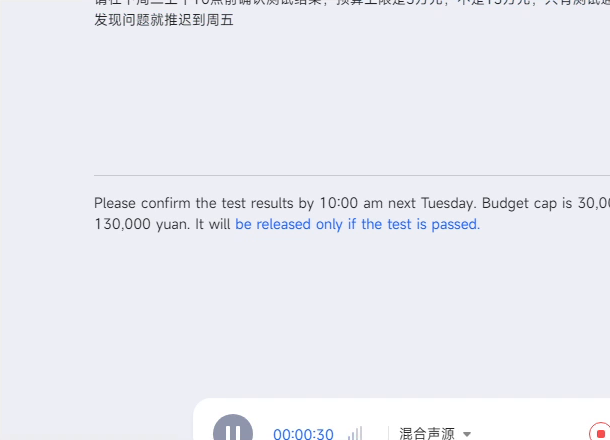

**N02 · 正常再次输入 · iflytek-v01 / 84.000s**

同一会话再次播放同一S01。前一轮译音至62.8秒结束，本轮57.1秒已输入；本轮译音66.5秒起，可依先后及内容分段。不是独立热启动实验。

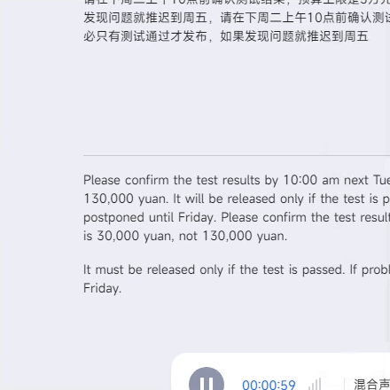

**S100 · 客户端上下行各100ms配置 · iflytek-v01 / 120.000s**

控制对象讯飞同传.exe，画面确认上下行各附加100ms，约94～123秒有效。输入与全部译音均在该配置状态内；实际业务损伤量未独立验证。

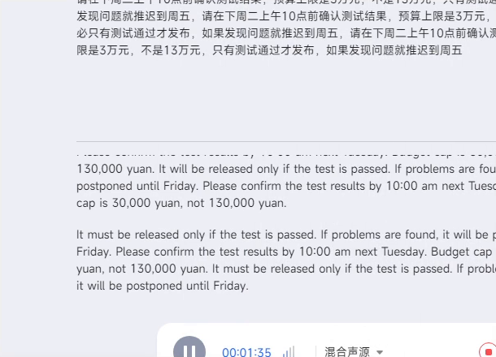

**Soff · 客户端中断相关输入 · iflytek-v01 / 142.000s**

输入125.9秒开始，约129～139秒显示连接中断；恢复至155.9秒再次输入前未见完整新S01。128.1秒附近只录到额外four，不能算有效首句。原有三段完整旧字幕不算本轮成功。

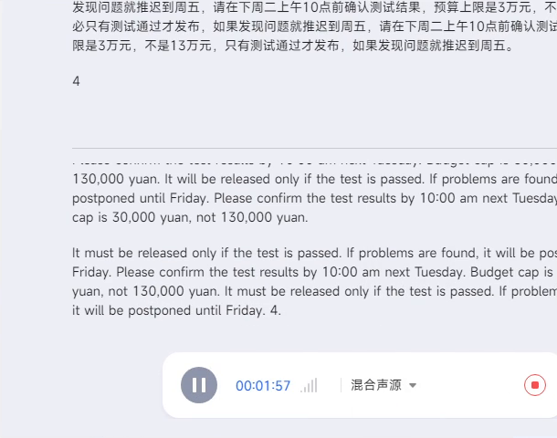

**Sdrop · 客户端上下行各10%丢包配置 · iflytek-v01 / 182.000s**

约155秒起上下行各配置10%概率丢包；约175～176秒人工撤销，译音181.1秒才结束。输入基本在配置期，播报尾段跨撤销；不能声称全段在10%下完成。

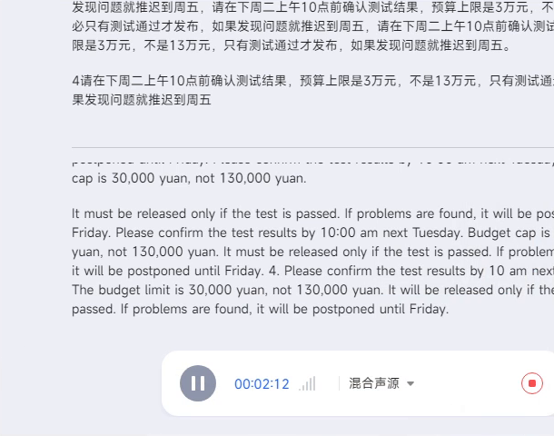

**R100 · 收听页100ms配置 · iflytek-v01 / 240.000s**

新Chrome配置收听页显示延迟100ms；客户端最终字幕与可见网页均完整。录音首句仅10 a.m. next Tuesday.，缺确认测试结果，F1记部分。此前另一个收听窗口仍存在，音频未按浏览器窗口独立隔离。

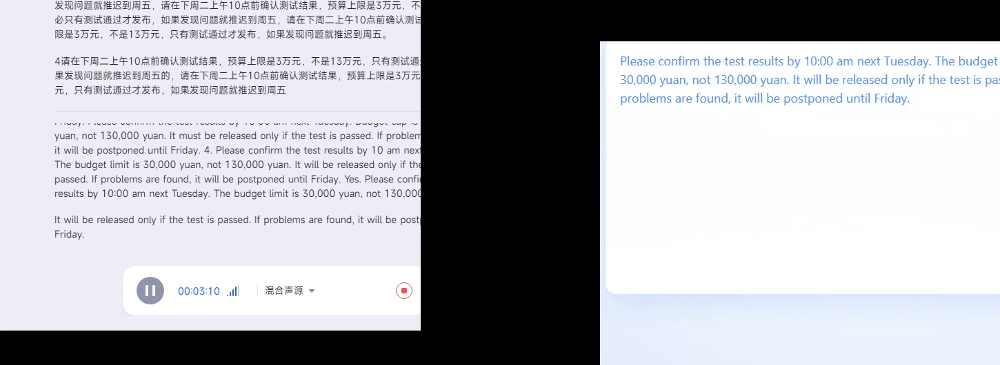

**Roff · 收听页Offline相关输入 · iflytek-v01 / 266.000s**

收听页约249～261秒显示离线；该期间仍更新字幕并录入译音，未证明实时业务连接真正断开。录音首句仅Results before 10 a.m. next Tuesday…，动作不完整；额外three另存。不能计算严格断流恢复耗时。

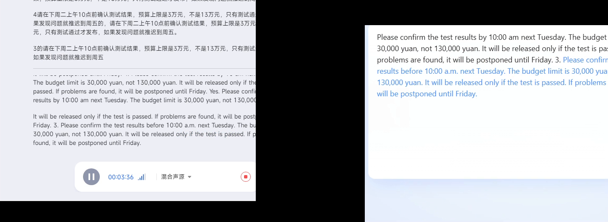

**Rdrop · 收听页WebRTC丢包10%配置 · iflytek-v01 / 308.000s**

可见收听页约273秒后选择WebRTC丢包10%；客户端本轮新字幕完整，可见收听页到308.6秒仍停留上轮文字。录音存在新英文但两次转写均未检出F4发布条件；多个收听窗口使译音来源和受控页面归属不唯一。

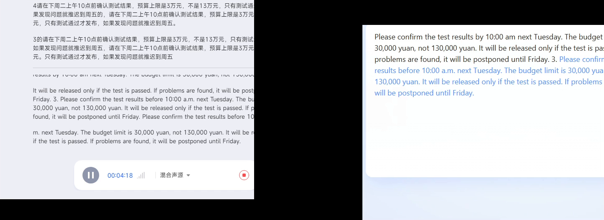

## 复现与数据说明

最终可见工作表以 CSV 值快照收录在 `data/tables/`，不含旧版工作簿、隐藏表、批注、个人作者信息或本机超链接。比较结论在 `data/comparison.csv`，场景与时间数据在 `data/results.json`、`data/timing.csv`。CSV 不保留原 Excel 公式和样式；本地原件不变。

综合对比原表另提供 [测试结论.xlsx](../测试结论.xlsx)：保留单元格、样式、绘图及公开来源批注，仅清空作者/修改人身份和本机工作目录属性。表内价格、政策及未实测功能描述保留当时记录，不作为最新报价或新增实测结论。清理与完整性记录见 `data/workbook-verification.json`。

`scripts/` 收录离线媒体检查与复算入口、实际使用的历史分析源码、现行弱网工具源码和相关测试源码。历史流程包含人工判定，不能以重跑 OCR/ASR 自动恢复所有结论；原始模型及未公开桌面原件也未随仓库分发。复现范围与所需输入见 [复现说明](reproducibility.md)。

## 隐私、素材筛选与完整性

仅收录最终评测记录引用的有效录像及最终表格值。废稿、修改前备份、未采用文本、原始 OCR/ASR 日志、截图候选、中间音频、缓存、模型、安装程序、运行状态与会话配置均不进入公开包。保留有效的 10% 丢包补录，它被最终 Transync 结果引用，不属于废稿。

用户已允许公开测试朗读与音色克隆声音。公开视频只保留测试相关音频时间区间，其他时间静音；可识别账号、会议码/二维码、浏览器个人内容和本机路径所在区域按固定/分时规则完全遮挡，不使用可逆模糊。截图由遮挡后同一帧派生，不复制带有个人信息的原图。详细规则、校验值、裁切终点和限制见 [隐私与证据说明](privacy.md)、`data/media-manifest.json`。

发布视频为重新编码的浏览副本。所有定量测量沿用本地原件结果；不以压缩副本、AAC 压缩音频或遮挡后的图像重新宣称同等精度。原件校验值仅用于对照本地留存文件，不提供未脱敏原件下载。
